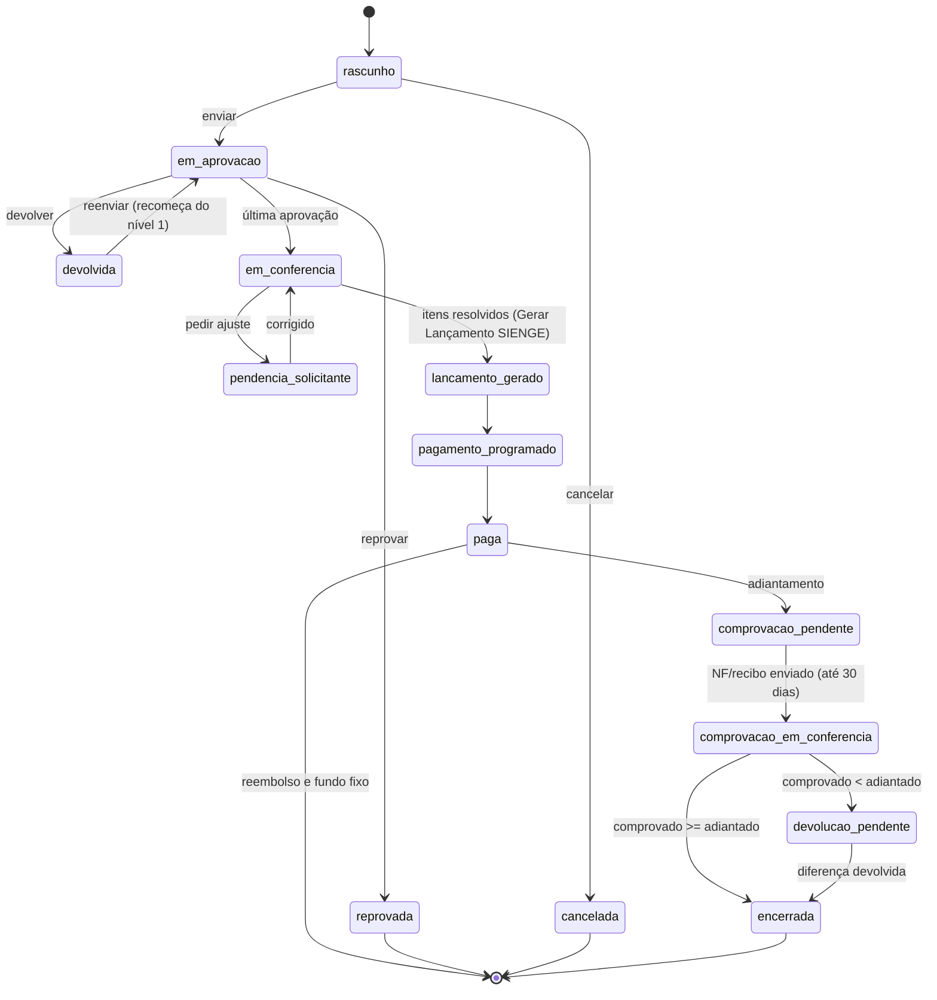

# PRD — Solicitações Financeiras (Reembolso, Fundo Fixo e Adiantamento) no Imobdesk

16/10/2026 · Wagner Antunes

## Visão geral

O Imobdesk ganha um módulo **Solicitações Financeiras** que digitaliza os formulários padrão 2026 de **Reembolso de Despesas** e **Fundo Fixo de Caixa (caixinha) e Adiantamento de Numerário**. O colaborador preenche pela web ou pelo app, os gestores da equipe aprovam em sequência e o Financeiro confere item a item antes de gerar o lançamento no SIENGE.

**Problema hoje:** os formulários circulam em planilha, os comprovantes vão separados para o workflow e as assinaturas dependem de DocuSign. O conferente não tem como cruzar valor declarado com comprovante sem abrir arquivo por arquivo.

**Objetivos**

1. Eliminar a planilha: 100% das solicitações de reembolso e fundo fixo abertas pelo portal.
2. Aprovação rastreável: timeline com quem aprovou, quando e com qual comentário, em 1 ou mais níveis definidos no cadastro de equipes.
3. Conferência mais rápida: OCR lê data, valor e favorecido de cada comprovante e o sistema aponta divergências contra as regras de aceitação.
4. Menos digitação no fundo fixo: as linhas do formulário nascem do comprovante (OCR + sugestão de motivo).
5. Pagamento no padrão de 15 dias após a conferência, com lançamento gerado no SIENGE; no adiantamento, pagamento no vencimento e comprovação controlada em até 30 dias, com bloqueio de novos adiantamentos para quem estiver em atraso.

O módulo é um tipo de chamado próprio, separado do ticket de atendimento já implantado. Só a equipe marcada como **financeira** recebe essas solicitações.

Mockups: [Imobdesk — Solicitações Financeiras](https://claude.ai/artifact/Jwj2RnUZFJs9NaXd8TMAR8) (telas 1 a 15).

## Escopo

**Dentro**

- Formulários de Reembolso, Fundo Fixo e Adiantamento de Numerário (web e app), com rascunho, anexos e aceite eletrônico.
- Cadastro de aprovadores por equipe: ordem, alçada por valor, substituto, prazo, modo (sequencial, paralelo, qualquer um).
- Fila do aprovador, detalhe da solicitação e timeline.
- Fila do Financeiro, conferência item a item, preview do formulário no layout 2026 e visualizador de comprovantes.
- OCR de comprovantes (web e app) com preenchimento automático e sugestão de motivo/descrição.
- Motor de regras de aceitação e detecção de duplicidade.
- Geração do lançamento no SIENGE e do PDF do formulário com comprovantes.
- Notificações por e-mail e no portal em cada mudança de etapa. Comprovação do adiantamento (NF ou recibo) com acerto de saldo e controle de prazo.

**Fora (nesta versão)**

- Prestação de contas de cartão corporativo.
- Pagamento executado pelo portal (o pagamento segue no SIENGE/banco).
- Assinatura via DocuSign ou TOTVS Sign (substituída pelo aceite eletrônico e pelas aprovações registradas; ver Decisões em aberto).

## Personas e permissões

| Perfil | Quem é | Vê | Pode |
| --- | --- | --- | --- |
| Colaborador | Qualquer usuário ativo | Só as próprias solicitações | Criar, salvar rascunho, anexar, enviar, corrigir quando devolvida, cancelar antes da 1ª aprovação |
| Aprovador | Usuário listado em `equipe_aprovador` | Solicitações em que é etapa atual ou já passou por ele | Aprovar, devolver para ajuste, reprovar, definir substituto por período |
| Conferente financeiro | Membro de equipe com `is_financeiro = true` | Solicitações com status de conferência em diante | Conferir itens, aceitar, glosar, pedir ajuste, devolver, gerar lançamento SIENGE, programar pagamento |
| Administrador | Super admin do portal | Tudo | Cadastrar equipes, aprovadores, alçadas, regras de aceitação, categorias de motivo, valor do fundo fixo por colaborador |

Um usuário pode ter mais de um perfil. Quando o solicitante também é aprovador da própria equipe, sua etapa é pulada e a solicitação segue para o nível seguinte.

## Fluxo do processo



Devolver leva a solicitação de volta ao colaborador e, ao reenviar, a aprovação recomeça do nível 1; reprovar encerra. Reembolso e fundo fixo terminam em Paga. O adiantamento segue para a comprovação em até 30 dias e só é encerrado quando ela é aceita ou quando a diferença é devolvida. O cancelamento só é possível em rascunho ou antes da primeira aprovação.

## Requisitos funcionais

Os números entre parênteses são as telas do mockup.

**RF-01 Minhas solicitações (1).** Cards para iniciar Reembolso ou Fundo fixo, contadores por status e histórico com busca. Clique abre o detalhe com timeline.

**RF-02 Formulário de Reembolso (2, 4).**

1. Cabeçalho travado vindo do cadastro: funcionário, CPF (mascarado), departamento, equipe.
2. Competência: mês, período de/até e centro de custo/obra (lista do SIENGE).
3. Linhas: data, valor, descrição/fornecedor, motivo e comprovante obrigatório por linha.
4. Total calculado; envio bloqueado com linha sem comprovante.
5. Painel lateral mostra a cadeia de aprovação que será aplicada ao valor total.
6. Aceite eletrônico obrigatório para enviar; rascunho salvo automaticamente.

**RF-03 Formulário de Fundo fixo (3, 11, 12).** Mesmos itens do RF-02, com: valor do fundo fixo (cadastro do colaborador), saldo inicial (saldo final anterior + reposição recebida), linhas com **favorecido** no lugar de descrição, despesas totais, saldo final = saldo inicial − despesas e reposição solicitada = despesas totais. Linhas podem nascer do OCR (RF-08).

**RF-04 Fila do aprovador (5).** Abas "Aguardando mim", "Aprovadas por mim" e "Todas da equipe". Mostra etapa ("2 de 2"), tempo com o aprovador e prazo, e sinaliza pendência de comprovante.

**RF-05 Detalhe e decisão (6).** Itens, prévias dos comprovantes, comentários e timeline. Ações: aprovar, devolver para ajuste e reprovar; as duas últimas exigem comentário. Devolver reabre para o colaborador; ao reenviar, a aprovação recomeça do nível 1.

**RF-06 Fila do Financeiro (8).** Contadores por etapa (a conferir, pendência, lançamento SIENGE gerado, pagamento programado, pagas no mês), lista ordenada pela aprovação mais antiga, coluna "pagar até" = última aprovação + 15 dias.

**RF-07 Conferência item a item (9).**

1. Lista de itens com status (aceito, divergente, pendente).
2. Visualizador do comprovante: zoom, girar, tela cheia e download; PDF renderizado na própria tela.
3. Quadro "Declarado × lido pelo OCR" para data, valor, favorecido, documento e motivo.
4. Checklist das regras de aceitação (seção própria) com resultado por regra.
5. Decisão por item: aceitar, pedir ajuste ou glosar, com observação.
6. "Concluir e Gerar Lançamento SIENGE" só habilita com todos os itens resolvidos; valor a pagar = total − glosas.
7. Botão "Preview do formulário" e download dos comprovantes em .zip.

**RF-08 OCR de comprovantes (11, 12).** Upload múltiplo na web (arrastar e soltar) e câmera no app. Detalhes na seção de OCR.

**RF-09 Preview do formulário (10).** Renderiza o formulário no layout padrão 2026 (cabeçalho, tabela, totais, informações de preenchimento e bloco de aceites com nome e data/hora). Ações: zoom, imprimir e baixar PDF. A lateral lista os comprovantes e abre cada um. O mesmo PDF segue anexado no lançamento do SIENGE.

**RF-10 Equipes e aprovadores (7).** Dados da equipe, centro de custo padrão, modo de aprovação, aprovadores ordenados com alçada mínima e substituto, prazo por etapa, ação ao vencer o prazo e flag de equipe financeira. Para o Adiantamento há uma cadeia própria em 4 níveis sequenciais: Planejamento (só quando a despesa é de obra), Gerente (sempre), Diretor e Presidente (por valor acima da alçada). Também ficam aqui o prazo de comprovação, a ação ao vencer e o limite de adiantamentos em aberto por pessoa. Prévia em texto mostra quem aprovaria para dois valores de exemplo.

**RF-11 Notificações.** E-mail e aviso no portal para: envio, cada aprovação, devolução, reprovação, chegada no Financeiro, pendência de conferência, lançamento gerado e pagamento programado. Lembrete ao aprovador quando faltar 25% do prazo e escalonamento ao substituto quando vencer.

**RF-12 Formulário de Adiantamento de numerário (13).** Segue o modelo "Adiantamento de Numerário" da empresa:

1. Documento de origem: anexar pedido de compras, proposta ou e-mail. O OCR lê nº do pedido, valor total, fornecedor, CNPJ e condição de pagamento (ex.: 50% sinal) e o sistema calcula o valor do adiantamento (total × percentual).
2. Obra e apropriação: obra (empresa pagadora), data do preenchimento (automática), conta caixa, conta de pagamento, centro de custo, centro de apuração e rateio por tarefa com porcentagem. O rateio precisa fechar 100%.
3. Valor, valor por extenso (gerado automaticamente), favorecido, CPF/CNPJ e finalidade.
4. Forma de pagamento: depósito, boleto, cheque ou dinheiro. Para depósito: banco, agência, conta e tipo (corrente ou poupança).
5. Vencimento e prazo máximo de comprovação, calculado como vencimento + 30 dias e configurável na equipe.
6. Aceite eletrônico com o termo de responsabilidade pela comprovação. Ele substitui a assinatura do funcionário.
7. A lateral mostra quais níveis de aprovação valem para aquele valor e aquela obra.

**RF-13 Detalhe do adiantamento (14).** O aprovador vê os dados no layout do formulário, as prévias do pedido e do e-mail e as checagens automáticas:

- o valor bate com o percentual do pedido;
- o CNPJ do favorecido é igual ao do pedido;
- o pedido não tem outro adiantamento em aberto.

A timeline vai de Enviado até Encerrado: Planejamento → Gerente → Diretor → Presidente (os níveis não exigidos aparecem como "não exigido para este valor") → Conferência financeira → Lançamento SIENGE → Pagamento no vencimento → Comprovação → Encerrado.

**RF-14 Comprovação do adiantamento (15).** Depois do pagamento, a solicitação vai para **Comprovação pendente**.

1. O colaborador anexa NF, recibo ou foto. O OCR lê tipo, emissão, emitente, valor e referência ao pedido.
2. Regras aplicadas: o emitente é o favorecido, a nota é posterior ao adiantamento e está no prazo, o valor é maior ou igual ao adiantado e a nota não foi usada em outra comprovação.
3. Acerto: se o comprovado for igual ou maior que o adiantado, o adiantamento fica comprovado, e o saldo do pedido gera um novo lançamento contra a nota. Se for menor, gera uma pendência de devolução da diferença.
4. O Financeiro confere a comprovação na mesma tela de conferência item a item (9) e encerra a solicitação.
5. Lembretes são enviados 7 dias e 1 dia antes do prazo. Se o prazo vencer, o gestor é avisado e novos adiantamentos ficam bloqueados para o solicitante.

## Regras de aceitação dos comprovantes

Cada regra roda automaticamente ao anexar e de novo na conferência. Resultado por item: **ok**, **alerta** (conferente decide) ou **bloqueio** (impede o envio pelo colaborador). Os parâmetros ficam na tabela `sf_regra` e são editáveis pelo administrador.

| Código | Regra | Como verifica | Resultado se falhar |
| --- | --- | --- | --- |
| R01 | Comprovante anexado | Toda linha tem ao menos um anexo | Bloqueio |
| R02 | Legível | Legibilidade ≥ 80% em data, valor e favorecido; abaixo disso o campo não é copiado | Alerta |
| R03 | Data no período | Data lida entre período de/até da competência | Alerta |
| R04 | Valor confere | Valor lido = valor declarado (tolerância configurável, padrão R$ 0,00) | Alerta, mostra a diferença |
| R05 | Documento fiscal | NF-e, NFC-e, cupom ou recibo com CNPJ/CPF do emissor | Alerta |
| R06 | Sem duplicidade | Hash SHA-256 do arquivo e combinação CNPJ + data + valor não usados em outra solicitação | Bloqueio |
| R07 | Categoria permitida | Itens lidos não batem com lista proibida (ex.: bebida alcoólica, tabaco) | Alerta |
| R08 | Limite por categoria | Valor do item ≤ teto da categoria de motivo, quando houver teto | Alerta |
| R09 | Prazo de envio | Solicitação enviada até N dias após o fim da competência (padrão: \[DEFINIR\]) | Alerta |
| R10 | Saldo do fundo fixo | Despesas totais ≤ saldo inicial | Bloqueio |

O conferente pode aceitar um item com alerta, mas precisa registrar observação. Glosa retira o valor do pagamento e fica registrada na timeline.

**Regras específicas do adiantamento**

| Código | Regra | Como verifica | Resultado se falhar |
| --- | --- | --- | --- |
| A01 | Documento de origem | Pedido, proposta ou e-mail anexado | Bloqueio |
| A02 | Valor x pedido | Valor adiantado ≤ valor do pedido × percentual da condição | Alerta |
| A03 | Favorecido x pedido | CNPJ do favorecido = CNPJ do fornecedor do pedido | Alerta |
| A04 | Titularidade bancária | Conta informada pertence ao CPF/CNPJ do favorecido (conferência do Financeiro) | Alerta |
| A05 | Rateio | Soma das porcentagens por tarefa = 100% | Bloqueio |
| A06 | Adiantamento em aberto | Pedido sem outro adiantamento não comprovado; solicitante abaixo do limite de adiantamentos em aberto e sem comprovação vencida | Bloqueio |
| A07 | Comprovação | Emitente = favorecido, emissão após o pagamento e até o prazo, valor ≥ adiantado, nota não usada antes | Alerta; valor menor gera devolução |

## OCR e sugestão de motivo

O OCR roda numa Edge Function do Supabase que envia o comprovante (imagem ou PDF) à API da Anthropic com visão e recebe um JSON estruturado. A IA não sugere data, valor nem favorecido: transcreve exatamente o que está impresso, campo a campo, e só copia o campo com legibilidade de 80% ou mais. A única sugestão é o motivo/descrição. O mesmo serviço atende o app e a web, e o resultado fica gravado no anexo para reuso na conferência.

**Fluxo**

1. Colaborador envia um ou vários arquivos (JPG, PNG, HEIC, PDF, até 10 MB). No app, a câmera recorta o comprovante antes do envio.
2. O arquivo vai para o Storage (bucket privado `sf-comprovantes`), e o hash SHA-256 é calculado.
3. A função `sf-ocr` é chamada; o anexo fica com status `lendo` (fila visível na tela 11).
4. Data, valor e favorecido (e CNPJ) com legibilidade ≥ 80% são copiados para o formulário, em azul e com a legibilidade de cada campo. Campo abaixo de 80% fica vazio para preenchimento manual. O motivo recebe até 3 sugestões.
5. Colaborador confirma ou edita; a linha registra a origem: `ocr_confirmado`, `ocr_editado` ou `manual`.
6. Data, valor ou favorecido abaixo de 80% marca o anexo como `ilegivel` e pede nova foto ou preenchimento manual.

**Contrato de saída da função**

```json
{
  "tipo_documento": "nfce | nfe | cupom | recibo | outro",
  "data": "2026-09-16",
  "valor_total": 198.50,
  "favorecido": "Ferragens Ideal Ltda",
  "cnpj_cpf_emissor": "00000000000000",
  "chave_acesso": null,
  "itens": [{"descricao": "DISCO CORTE 7", "valor": 38.50}],
  "motivo_sugestoes": [
    {"categoria_id": "ferramentas", "texto": "Ferramentas — reposição", "confianca": 0.86}
  ],
  "legibilidade": {"data": 0.99, "valor": 0.98, "favorecido": 0.95},
  "alertas": ["possivel_bebida_alcoolica"]
}
```

**Sugestão de motivo.** O prompt recebe a lista de categorias ativas de `sf_categoria_motivo` (nome, descrição, palavras-chave) e os itens lidos. Deve escolher só entre essas categorias e devolver um texto curto no padrão "Categoria — detalhe". Quando o colaborador troca a sugestão, a escolha é registrada para calibrar as palavras-chave.

**NFC-e com QR code.** Quando houver chave de acesso, ela é guardada no anexo; consulta à SEFAZ fica para fase futura.

**OCR no adiantamento.** A mesma função recebe `modo` = `pedido_compra` ou `comprovacao`. No pedido, ela devolve nº do pedido, data, fornecedor, CNPJ, valor total e condição de pagamento, e o sistema calcula o valor (total × percentual). Na comprovação, ela lê a NF-e/recibo (emitente, CNPJ, emissão, valor e referência ao pedido) e alimenta a regra A07.

## Modelo de dados

Todas as tabelas ficam no schema `porta_atendimento`, com prefixo `sf_`, em migrations aditivas versionadas no Git. Valores monetários usam `numeric(14,2)` e datas usam `date`/`timestamptz`.

| Tabela | Para que serve | Colunas principais |
| --- | --- | --- |
| `sf_solicitacao` | Cabeçalho da solicitação | id, numero (SF-AAAA-NNNN), tipo (reembolso, fundo\_fixo), solicitante\_id, equipe\_id, departamento, centro\_custo\_id, competencia (date, 1º dia), periodo\_de, periodo\_ate, valor\_fundo\_fixo, saldo\_inicial, total\_despesas, saldo\_final, valor\_glosado, valor\_a\_pagar, status, etapa\_atual, aceite\_em, aceite\_ip, pagar\_ate, sienge\_lancamento\_id, created\_at |
| `sf_item` | Linha de despesa | id, solicitacao\_id, ordem, data, valor, descricao\_favorecido, motivo, categoria\_id, origem (manual, ocr\_confirmado, ocr\_editado), status\_conferencia (pendente, aceito, ajuste, glosado), obs\_conferente |
| `sf_anexo` | Comprovante | id, item\_id, storage\_path, mime, tamanho, sha256, ocr\_status (fila, lendo, lido, ilegivel, erro), ocr\_json (jsonb), ocr\_confianca, chave\_acesso |
| `sf_regra_resultado` | Resultado das regras por item | id, item\_id, regra\_codigo, resultado (ok, alerta, bloqueio), detalhe, avaliado\_em |
| `sf_aprovacao` | Etapas da timeline (cadeia congelada no envio) | id, solicitacao\_id, ciclo, nivel, aprovador\_id, substituto\_id, papel (gestor, financeiro), status (aguardando, aprovado, devolvido, reprovado, pulado), comentario, prazo\_em, decidido\_em |
| `sf_evento` | Log imutável de tudo que aconteceu | id, solicitacao\_id, tipo, ator\_id, payload jsonb, created\_at |
| `equipe_aprovador` | Cadastro de aprovadores por equipe | id, equipe\_id, usuario\_id, ordem, alcada\_minima, substituto\_id, ativo |
| `equipe` (já existe) | Recebe colunas novas | modo\_aprovacao, prazo\_horas, acao\_prazo\_vencido, centro\_custo\_padrao\_id, is\_financeiro |
| `sf_fundo_fixo` | Valor do caixinha por colaborador | usuario\_id, valor, vigente\_desde, ativo |
| `sf_categoria_motivo` | Categorias para sugestão e limite | id, nome, descricao, palavras\_chave text\[\], teto\_valor, ativo |
| `sf_regra` | Parâmetros das regras R01–R10 | codigo, ativo, severidade, parametros jsonb |

O status da solicitação segue a máquina de estados da seção de fluxo e só muda via funções RPC (`sf_enviar`, `sf_decidir_aprovacao`, `sf_decidir_item`, `sf_concluir_conferencia`), nunca por update direto.

**Acréscimos para o adiantamento**

| Tabela | Colunas |
| --- | --- |
| `sf_solicitacao` (novas colunas) | tipo passa a aceitar `adiantamento`; obra\_id, conta\_caixa, conta\_pagamento\_id, centro\_apuracao\_id, favorecido, favorecido\_doc, finalidade, forma\_pagamento (deposito, boleto, cheque, dinheiro), banco, agencia, conta, tipo\_conta, vencimento, prazo\_comprovacao, pedido\_numero, pedido\_valor, pedido\_percentual, status\_comprovacao (pendente, enviada, aceita, devolucao, vencida) |
| `sf_rateio` | id, solicitacao\_id, tarefa, porcentagem, valor |
| `sf_comprovacao` | id, solicitacao\_id, anexo\_id, tipo\_documento, emitente\_doc, emissao, valor, saldo\_devolver, saldo\_pagar, conferida\_por, conferida\_em |
| `equipe_aprovador` (nova coluna) | tipo\_solicitacao (reembolso\_fundo\_fixo, adiantamento), papel (planejamento, gerente, diretor, presidente), condicao (sempre, obra, valor\_acima) |
| `equipe` (novas colunas) | prazo\_comprovacao\_dias (padrão 30), acao\_comprovacao\_vencida, limite\_adiantamentos\_abertos |

A máquina de estados do adiantamento estende a geral: depois de `paga` vem `comprovacao_pendente`, depois `comprovacao_em_conferencia`, depois `encerrada`. O desvio `devolucao_pendente` vale quando o comprovado é menor que o adiantado.

## Integrações

| Integração | Uso | Implementação |
| --- | --- | --- |
| SIENGE (API REST) | Gerar o título a pagar ao concluir a conferência, com PDF do formulário e comprovantes anexos; listar centros de custo/obras e credores | Edge Function `sf-sienge-lancamento`; credenciais no Vault; idempotência pela chave `numero` da solicitação; resposta grava `sienge_lancamento_id` |
| Anthropic API (visão) | OCR e sugestão de motivo | Edge Function `sf-ocr`; chave no Vault; resposta validada por schema antes de gravar |
| Supabase Storage | Comprovantes e PDF gerado | Bucket privado `sf-comprovantes`; acesso só por URL assinada de curta duração |
| Geração de PDF | Preview e anexo do lançamento no layout padrão 2026 | Edge Function `sf-pdf` (HTML → PDF); mesmo template do preview da tela 10 |
| E-mail e notificações do portal | Avisos de etapa, lembrete e escalonamento | Reusar o serviço de notificação do Imobdesk; job agendado (pg\_cron) checa prazos a cada 30 min |

O credor no SIENGE é o colaborador. Se ele não existir como credor, a função retorna erro claro para o conferente, sem criar cadastro automaticamente (ver Decisões em aberto).

No adiantamento, a função `sf-sienge-lancamento` cria um título de adiantamento a fornecedor (ou a funcionário), com vencimento na data informada e apropriação por obra, centro de custo e tarefa conforme o rateio. Quando a comprovação é aceita, uma segunda chamada vincula a NF e compensa o adiantamento no SIENGE. O formulário e o pedido de origem vão anexados nas duas chamadas.

## Segurança e requisitos não funcionais

**RLS (todas as tabelas `sf_` com RLS ligada)**

- Colaborador: `select` onde `solicitante_id = auth.uid()`; `insert`/`update` só com status `rascunho` ou `devolvida`.
- Aprovador: `select` onde existe linha em `sf_aprovacao` com `aprovador_id` ou `substituto_id = auth.uid()`.
- Financeiro: `select` onde o status é `em_conferencia` ou posterior e o usuário pertence a equipe com `is_financeiro`.
- Mudanças de status só via funções `security definer` que validam o papel e a etapa atual.
- Anexos herdam a política da solicitação; Storage com políticas espelhadas e URLs assinadas de 5 minutos.

**Dados pessoais (LGPD).** CPF mascarado na tela e completo só no PDF e no SIENGE. `sf_evento` guarda IP e user-agent do aceite. Comprovantes retidos pelo prazo fiscal definido pelo Financeiro.

**Desempenho.** OCR responde em até 10 s por arquivo (p95); filas exibem até 50 linhas paginadas; preview do PDF abre em até 3 s.

**Confiabilidade.** Funções SIENGE e OCR com retentativa exponencial (3 tentativas) e status de erro visível. Chamadas ao SIENGE são idempotentes.

**Acessibilidade e mobile.** Layout responsivo com alvo de toque ≥ 44 px; formulário do app funciona com rede instável, salvando o rascunho localmente até sincronizar.

**Auditoria.** Toda ação gera um registro em `sf_evento`; a timeline é montada a partir dele e de `sf_aprovacao`.

## Fases e critérios de aceite

Cada fase só começa quando todos os itens da anterior estão marcados.

**Fase 1 — Base de dados e cadastros**

- [ ] Migrations `sf_*` e colunas novas em `equipe` aplicadas sem erro
- [ ] RLS testada com 4 usuários (colaborador, aprovador, financeiro, admin): cada um vê só o que a seção de segurança define
- [ ] Tela 7 grava modo, aprovadores ordenados, alçada, substituto e flag financeira
- [ ] Cadastro de valor do fundo fixo por colaborador e de categorias de motivo

**Fase 2 — Formulários e envio**

- [ ] Telas 1, 2 e 3 funcionando com rascunho automático
- [ ] Envio bloqueado sem comprovante ou sem aceite
- [ ] Saldo final e reposição do fundo fixo calculados corretamente em 3 cenários de teste
- [ ] `sf_enviar` congela a cadeia em `sf_aprovacao` respeitando alçada e pulando o próprio solicitante

**Fase 3 — Aprovação**

- [ ] Telas 5 e 6 com aprovar, devolver e reprovar; comentário obrigatório nos dois últimos
- [ ] Devolução reabre e reinicia do nível 1 em novo `ciclo`
- [ ] Lembrete e escalonamento ao substituto disparam pelo job de prazo
- [ ] Notificações por e-mail em cada etapa

**Fase 4 — OCR**

- [ ] Edge Function `sf-ocr` retorna o contrato JSON em 20 comprovantes reais da empresa com ≥ 90% de acerto em data e valor
- [ ] Telas 11 e 12: upload múltiplo, câmera, fila de leitura, campos copiados em azul com legibilidade (mínimo 80%)
- [ ] Sugestão de motivo usa só categorias ativas
- [ ] Regras R01–R10 gravadas em `sf_regra_resultado`

**Fase 5 — Conferência, preview e SIENGE**

- [ ] Telas 8, 9 e 10 completas, com visualizador de imagem e PDF
- [ ] PDF no layout 2026 idêntico entre preview e anexo
- [ ] Lançamento criado no SIENGE em homologação com anexos, sem duplicar em retentativa
- [ ] "Pagar até" calculado e exibido em todas as telas

**Fase 5B — Adiantamento de numerário**

- [ ] Tela 13 com OCR do pedido sugerindo o valor; rateio fechando 100%; valor por extenso automático
- [ ] Cadeia Planejamento → Gerente → Diretor → Presidente respeitando condição de obra e alçada (testada com 3 valores)
- [ ] Tela 14 com checagens A02, A03 e A06 e timeline completa até Encerrado
- [ ] Lançamento de adiantamento no SIENGE em homologação, com rateio por tarefa
- [ ] Tela 15: comprovação com OCR da NF, acerto de saldo (maior, igual, menor) e compensação no SIENGE
- [ ] Lembretes de prazo e bloqueio de novos adiantamentos por comprovação vencida

**Fase 6 — App e piloto**

- [ ] Fluxo completo no app (rascunho offline, câmera, envio)
- [ ] Piloto com 1 equipe de obras por 1 competência mensal completa
- [ ] Planilhas aposentadas para a equipe piloto

## Design system do Imobdesk

O módulo usa o mesmo visual do Imobdesk em produção: sidebar escura, vermelho da marca nos itens ativos e nas ações principais, fundo cinza-claro e cards brancos com borda fina. Os valores abaixo foram medidos nos mockups. Se o repositório já tiver tokens (Tailwind, variáveis CSS, tema do shadcn), **os tokens do repositório valem**, e esta tabela serve só para o mapeamento.

**Cores**

| Token | Valor | Uso |
| --- | --- | --- |
| `brand` | #C41E2A | Botão primário, item ativo do menu, links, destaque |
| `brand-hover` | #9B1620 | Hover do primário e de links |
| `brand-soft` | #FDECEE | Fundo de ícone e de linha selecionada |
| `sidebar` | #1E1F24 | Fundo do menu lateral |
| `sidebar-hover` | #2B2D33 | Hover de item do menu |
| `sidebar-text` | #E4E6EA / #C9CCD3 | Item / subitem do menu |
| `sidebar-label` | #A3A7B0 | Rótulo "MENU PRINCIPAL" |
| `bg` | #F4F5F7 | Fundo da página |
| `surface` | #FFFFFF | Cards, tabelas, header |
| `border` | #E3E5EA | Borda de card e divisórias |
| `border-input` | #D5D8DE | Borda de inputs e botões secundários |
| `text` | #1B1D22 | Texto principal |
| `text-secondary` | #4F5562 | Texto de apoio, cabeçalho de tabela |
| `text-label` | #3A3F4A | Rótulos de campo |
| `readonly` | #F1F2F4 | Campo somente leitura |
| `ocr` | borda #6C8FD8, fundo #F3F7FF, texto #173B86 | Campo copiado do comprovante pelo OCR |
| `success` | #1D6B34 | Botão Aprovar, check de regra ok |
| `danger` | #B0181F | Reprovar, glosa, divergência |

**Chips de status** (fundo / texto, pílula com raio 999 px, 12 px, peso 600)

| Status | Fundo | Texto |
| --- | --- | --- |
| Rascunho | #EEF0F3 | #3A3F4A |
| Aguardando gestor, Em conferência, Comprovação pendente, Vence em | #FFF1E5 | #8A3F00 |
| Devolvida para ajuste, Pendência | #F1EAFC | #5B2AA0 |
| Aguardando pagamento, Lançamento gerado | #E8EFFC | #1F4FB3 |
| Aprovada, Paga, Encerrado, Comprovante anexado | #E6F4EA | #1D6B34 |
| Reprovada, Vencido, Divergente | #FDECEE | #A3141C |

**Tipografia.** Inter, com fallback system-ui. Títulos de página 28–32 px/700; título de card 17 px/700; corpo 14–15 px/400; rótulo 13 px/600; legenda e chip 12 px; eyebrow 12 px/700 em caixa alta com espaçamento 0,14em e cor `brand`.

**Espaço e forma.** Grade de 4 px. Padding de card 20–22 px, gap entre cards 16–20 px, gap de formulário 14–16 px. Raio: card 12 px, input e botão 8–10 px, chip 999 px. Sem sombras nos cards (só a borda). Altura mínima de controles: 44 px (48 px nos botões de ação final, 52 px no app).

**Componentes**

| Componente | Regra |
| --- | --- |
| AppShell | Header branco (logo, "PORTAL DE TICKETS", data, usuário e perfil) + sidebar 260–300 px + conteúdo com padding 28–36 px. No celular, a sidebar empilha acima do conteúdo. |
| Sidebar | Grupo "Solicitações Financeiras" com Minhas solicitações, Nova solicitação, Aprovações (com contador) e Conferência financeira (só para equipe financeira); em Administração, "Equipes e aprovadores". |
| PageHeader | Breadcrumb, eyebrow opcional, título, subtítulo e ações à direita |
| KpiCard | Rótulo 13 px, número 26–30 px/700 com a cor do status, legenda 12 px; o card de alerta usa o fundo do status |
| DataTable | Cabeçalho 12 px em caixa alta; linhas de 14 px; rolagem horizontal dentro do card; nº da solicitação como link |
| StatusChip | Mapeamento da tabela de chips; nunca usar só a cor: sempre com texto |
| FormSection | Card numerado ("1. Dados do solicitante"), grid auto-fit de campos com mínimo de 200 px |
| Field / OcrField | Label acima do input; o OcrField usa o token `ocr` e mostra "copiado · legibilidade NN%" |
| ExpenseTable | Linhas editáveis (data, valor alinhado à direita, descrição/favorecido, motivo, comprovante, remover) + total |
| AttachmentChip / Dropzone | Chip verde com o nome do arquivo; dropzone tracejada com várias seleções |
| ApprovalTimeline | Lista vertical com marcador de 28 px: verde = concluído, borda laranja = etapa atual, tracejado = não exigido, cinza = futuro |
| ApproverChainPreview | Mostra no formulário quem vai aprovar para aquele valor e obra |
| DecisionBar | Reprovar (contorno danger), Devolver (contorno roxo), Aprovar (preenchido success) |
| ReceiptViewer | Fundo #2A2C31, zoom, girar, tela cheia, PDF renderizado; ao lado, o quadro Declarado × Comprovante |
| RuleChecklist | Linha por regra com ícone ok, alerta ou bloqueio e o detalhe |
| FormPreview | Página A4 no layout padrão 2026 da empresa, com a toolbar escura (fechar, zoom, imprimir, baixar PDF) |

**Acessibilidade.** Contraste de 4,5:1 no texto; botões e links reais (nada de div clicável); `aria-label` nos botões só de ícone; estados distinguidos por texto e ícone, não só por cor.

## Mapa de telas e rotas

| Tela | Rota sugerida | Perfil |
| --- | --- | --- |
| 1 Minhas solicitações | `/financeiro/solicitacoes` | Colaborador |
| 2 Reembolso | `/financeiro/solicitacoes/nova/reembolso` | Colaborador |
| 3 e 11 Fundo fixo + OCR | `/financeiro/solicitacoes/nova/fundo-fixo` | Colaborador |
| 13 Adiantamento | `/financeiro/solicitacoes/nova/adiantamento` | Colaborador |
| 15 Comprovação | `/financeiro/solicitacoes/:id/comprovacao` | Colaborador |
| 5 Aprovações | `/financeiro/aprovacoes` | Aprovador |
| 6 e 14 Detalhe e decisão | `/financeiro/solicitacoes/:id` | Todos (ações por perfil) |
| 8 Fila do Financeiro | `/financeiro/conferencia` | Financeiro |
| 9 Conferência item a item | `/financeiro/conferencia/:id` | Financeiro |
| 10 Preview do formulário | modal em `/financeiro/solicitacoes/:id?preview=1` | Todos com acesso |
| 7 Equipes e aprovadores | `/admin/equipes` | Administrador |
| 4 e 12 App | mesmas rotas, layout mobile | Colaborador |

## Prompt para o Claude Code (VS Code)

São dois prompts. O **prompt de implantação** é colado uma única vez no Claude Code, na raiz do repositório `vs_Portal_Atendimento`. Ele faz três coisas:

1. Grava todo o contexto (processo, regras, dados e design system) em `docs/solicitacoes-financeiras/CONTEXTO.md` e referencia esse arquivo no `CLAUDE.md`.
2. Implementa uma fase por vez.
3. Para ao fim de cada fase para você validar. Para continuar, responda "seguir para a Fase N".

O **prompt de ajuste** é para mudanças depois: ele faz o Claude Code reler o contexto gravado e atualizá-lo junto com o código. Este arquivo deve ficar no repositório como `docs/solicitacoes-financeiras/PRD.md`.

**Prompt de implantação**

```text
Você vai implementar no Imobdesk (este repositório) o módulo SOLICITAÇÕES FINANCEIRAS: Reembolso de Despesas, Fundo Fixo de Caixa (caixinha) e Adiantamento de Numerário. É um tipo de chamado próprio, separado do ticket de atendimento já existente, e só a equipe marcada como financeira recebe essas solicitações.

========================================
PASSO 0 — CONTEXTO PERMANENTE (faça antes de qualquer código)
========================================
1. Leia o CLAUDE.md da raiz e mapeie o projeto: stack, estrutura de pastas, roteamento, cliente Supabase, autenticação e perfis, tabela de equipes, serviço de notificação/e-mail, componentes do layout atual (header, sidebar, cards, chips) e onde ficam os tokens visuais (tailwind.config, variáveis CSS, tema shadcn).
2. Crie docs/solicitacoes-financeiras/CONTEXTO.md com TODO o conteúdo das seções 1 a 8 abaixo, sem resumir.
3. Acrescente ao CLAUDE.md uma seção "Módulo Solicitações Financeiras" dizendo: "Antes de qualquer alteração neste módulo, leia docs/solicitacoes-financeiras/CONTEXTO.md. Quando uma regra, estado, tabela ou componente mudar, atualize o CONTEXTO.md no mesmo commit."
4. Compare o design system da seção 7 com os tokens que já existem no repositório. Mostre-me uma tabela token do PRD -> token existente (ou "criar"). Os tokens do repositório têm prioridade; crie só o que faltar.
5. Mostre o plano da Fase 1 (arquivos a criar e alterar) e PARE.

========================================
1. PERFIS
========================================
- Colaborador: cria, salva rascunho, anexa, envia, corrige quando devolvida, cancela antes da 1ª aprovação, comprova adiantamento. Vê só as próprias solicitações.
- Aprovador: listado em equipe_aprovador. Aprova, devolve para ajuste, reprova, define substituto por período. Vê as solicitações em que é ou foi etapa.
- Conferente financeiro: membro de equipe com is_financeiro = true. Confere item a item, aceita, glosa, pede ajuste, devolve, gera lançamento no SIENGE, programa pagamento, confere comprovação. Vê status em_conferencia em diante.
- Administrador: cadastra equipes, aprovadores, alçadas, regras, categorias de motivo e o valor do fundo fixo por colaborador.
Se o solicitante também for aprovador da própria equipe, a etapa dele é pulada.

========================================
2. PROCESSO E MÁQUINA DE ESTADOS
========================================
Geral: rascunho -> em_aprovacao -> em_conferencia -> lancamento_gerado -> pagamento_programado -> paga.
Desvios: em_aprovacao -> devolvida -> (reenvio) em_aprovacao, recomeçando do nível 1 em novo ciclo; em_aprovacao -> reprovada (fim); em_conferencia -> pendencia_solicitante -> em_conferencia; cancelada só a partir de rascunho ou antes da 1ª aprovação.
Adiantamento continua após paga: comprovacao_pendente -> comprovacao_em_conferencia -> encerrada; se comprovado < adiantado: devolucao_pendente -> encerrada; se o prazo vencer: comprovação marcada vencida, aviso ao gestor e bloqueio de novos adiantamentos do solicitante.
Toda mudança de status passa por RPC security definer (sf_enviar, sf_decidir_aprovacao, sf_decidir_item, sf_concluir_conferencia, sf_enviar_comprovacao, sf_decidir_comprovacao). O frontend nunca faz update direto em status. Toda ação grava em sf_evento.
Prazos: reembolso e fundo fixo, pagar_ate = data da última aprovação + 15 dias. Adiantamento: paga no vencimento informado; prazo de comprovação = vencimento + prazo_comprovacao_dias da equipe (padrão 30).

========================================
3. FORMULÁRIOS
========================================
Cabeçalho comum, somente leitura e vindo do perfil: funcionário, CPF mascarado, departamento, equipe.
REEMBOLSO: mês de referência, período de/até, centro de custo/obra (lista do SIENGE); linhas com data, valor, descrição/fornecedor, motivo e comprovante obrigatório; total; aceite eletrônico.
FUNDO FIXO: valor do fundo (cadastro do colaborador), saldo inicial = saldo final anterior + reposição recebida; linhas com data, valor, favorecido, motivo/descrição e comprovante; despesas totais; saldo final = saldo inicial - despesas; reposição solicitada = despesas totais; aceite.
ADIANTAMENTO (modelo Adiantamento de Numerário da empresa): documento de origem (pedido de compras, proposta ou e-mail); obra (empresa pagadora); data do preenchimento automática; conta caixa; conta de pagamento; centro de custo; centro de apuração; rateio por tarefa com porcentagem (soma 100%); valor; valor por extenso gerado; favorecido; CPF/CNPJ; finalidade; forma de pagamento (depósito, boleto, cheque, dinheiro) com banco, agência, conta e tipo (corrente/poupança); vencimento; prazo máximo de comprovação; aceite com termo de responsabilidade pela comprovação.
COMPROVAÇÃO DO ADIANTAMENTO: anexar NF, recibo ou foto; acerto: comprovado >= adiantado encerra e gera lançamento do saldo do pedido contra a nota; menor gera devolução da diferença. Lembretes D-7 e D-1.
Rascunho é salvo automaticamente. O aceite eletrônico registra usuário, data/hora, IP e user-agent e substitui as assinaturas.

========================================
4. APROVAÇÃO
========================================
Cadastro por equipe em equipe_aprovador: tipo_solicitacao (reembolso_fundo_fixo | adiantamento), ordem/nível, papel, aprovador, substituto, condição (sempre | obra | valor_acima) e alcada_minima. Na equipe ficam: modo_aprovacao (sequencial | paralelo | qualquer_um), prazo_horas (48), acao_prazo_vencido (lembrar | escalar), is_financeiro, prazo_comprovacao_dias, acao_comprovacao_vencida, limite_adiantamentos_abertos.
Reembolso/fundo fixo: aprovador entra se total >= alcada_minima.
Adiantamento: sequencial, Planejamento (só se a despesa é de obra) -> Gerente (sempre) -> Diretor (valor acima da alçada) -> Presidente (valor acima da alçada). Níveis não exigidos aparecem na timeline como "não exigido para este valor".
No envio, a cadeia é CONGELADA em sf_aprovacao: mudanças posteriores no cadastro não afetam solicitações em andamento.
Devolver e reprovar exigem comentário. Job pg_cron a cada 30 min: lembrete com 25% do prazo restante e escalonamento ao substituto quando vencer.

========================================
5. OCR E REGRAS DE ACEITAÇÃO
========================================
OCR = Edge Function sf-ocr chamando a API da Anthropic (modelo com visão). Chave só no Vault.
PRINCÍPIO: a IA NÃO sugere data, valor nem favorecido. Ela TRANSCREVE literalmente o que está impresso, campo a campo, sem estimar, corrigir ou completar. Um campo só é copiado quando a legibilidade dele é >= 0,80; abaixo disso, volta null, fica vazio para preenchimento manual e o anexo é marcado ilegivel. A ÚNICA sugestão é o motivo/descrição: até 3 opções, escolhidas só entre as categorias ativas de sf_categoria_motivo enviadas no prompt.
Modos: comprovante (fundo fixo/reembolso), pedido_compra (adiantamento: nº do pedido, data, fornecedor, CNPJ, valor total, condição de pagamento; o sistema CALCULA valor = total x percentual) e comprovacao (NF/recibo do adiantamento).
Contrato de saída (validar com zod antes de gravar em sf_anexo.ocr_json): tipo_documento, data, valor_total, favorecido, cnpj_cpf_emissor, chave_acesso, itens[], motivo_sugestoes[{categoria_id, texto, confianca}], legibilidade{data, valor, favorecido}, alertas[]. Retentativa exponencial 3x; meta de 10 s por arquivo.
Na UI, campo copiado aparece em azul com "copiado · legibilidade NN%". A linha registra a origem: manual | ocr_confirmado | ocr_editado.
Regras (parâmetros em sf_regra; resultado em sf_regra_resultado: ok | alerta | bloqueio):
R01 comprovante anexado (bloqueio); R02 legibilidade >= 80% em data, valor e favorecido (alerta); R03 data dentro do período (alerta); R04 valor do comprovante = declarado, tolerância configurável (alerta); R05 documento fiscal com CNPJ/CPF (alerta); R06 duplicidade por SHA-256 e por CNPJ+data+valor (bloqueio); R07 itens proibidos (alerta); R08 teto por categoria (alerta); R09 prazo de envio (alerta); R10 despesas <= saldo do fundo (bloqueio).
A01 documento de origem (bloqueio); A02 valor <= pedido x percentual (alerta); A03 CNPJ do favorecido = fornecedor do pedido (alerta); A04 titularidade bancária (alerta); A05 rateio = 100% (bloqueio); A06 sem adiantamento em aberto no pedido, abaixo do limite por pessoa e sem comprovação vencida (bloqueio); A07 comprovação: emitente = favorecido, emissão após o pagamento e no prazo, valor >= adiantado, nota não usada (alerta; valor menor gera devolução).
Conferente pode aceitar item com alerta, mas com observação obrigatória. Glosa retira o valor do pagamento: valor_a_pagar = total - glosas.

========================================
6. DADOS E INTEGRAÇÕES
========================================
Schema porta_atendimento, prefixo sf_. Só migrations ADITIVAS e versionadas (supabase/migrations/AAAAMMDDHHMM_sf_<descricao>.sql). Dinheiro numeric(14,2); datas date/timestamptz. RLS ligada em todas as tabelas sf_.
Tabelas: sf_solicitacao (inclui tipo reembolso|fundo_fixo|adiantamento, numero SF-AAAA-NNNN, competência, período, totais, valor_glosado, valor_a_pagar, status, etapa_atual, aceite, pagar_ate, sienge_lancamento_id e os campos do adiantamento), sf_item, sf_anexo, sf_regra_resultado, sf_aprovacao (ciclo, nível, papel, status, comentário, prazo), sf_evento, sf_rateio, sf_comprovacao, equipe_aprovador, sf_fundo_fixo, sf_categoria_motivo, sf_regra; colunas novas em equipe.
RLS: colaborador vê solicitante_id = auth.uid(); aprovador vê onde é aprovador_id ou substituto_id em sf_aprovacao; financeiro vê em_conferencia em diante; admin vê tudo. Storage: bucket privado sf-comprovantes, políticas espelhadas, URLs assinadas de 5 min. CPF completo só no PDF e no SIENGE.
Edge Functions: sf-ocr; sf-pdf (HTML -> PDF no layout padrão 2026 da empresa, o mesmo template para preview e anexo); sf-sienge-lancamento (API REST do SIENGE: título a pagar ou de adiantamento com credor, centro de custo, rateio, vencimento e anexos; idempotente pelo numero; na comprovação, vincula a NF e compensa; credor inexistente = erro claro, sem cadastro automático). Credenciais no Vault. Antes de codar o SIENGE, mostre-me os endpoints que vai usar.
Notificações: reusar o serviço do portal (e-mail + aviso no portal) em envio, cada aprovação, devolução, reprovação, chegada no Financeiro, pendência, lançamento, pagamento, lembretes e vencimentos.

========================================
7. DESIGN SYSTEM (igual ao Imobdesk atual)
========================================
Cores: brand #C41E2A (primário, item ativo, links), brand-hover #9B1620, brand-soft #FDECEE; sidebar #1E1F24, sidebar-hover #2B2D33, texto da sidebar #E4E6EA / subitem #C9CCD3 / rótulo #A3A7B0; bg #F4F5F7; surface #FFFFFF; border #E3E5EA; border-input #D5D8DE; text #1B1D22; text-secondary #4F5562; text-label #3A3F4A; readonly #F1F2F4; ocr (borda #6C8FD8, fundo #F3F7FF, texto #173B86); success #1D6B34; danger #B0181F.
Chips (fundo/texto): rascunho #EEF0F3/#3A3F4A; aguardando, em conferência, comprovação pendente, vence em #FFF1E5/#8A3F00; devolvida, pendência #F1EAFC/#5B2AA0; aguardando pagamento, lançamento gerado #E8EFFC/#1F4FB3; aprovada, paga, encerrado #E6F4EA/#1D6B34; reprovada, vencido, divergente #FDECEE/#A3141C. Sempre texto no chip, nunca só cor.
Tipografia: Inter (fallback system-ui). Título de página 28-32/700; título de card 17/700; corpo 14-15; rótulo 13/600; chip e legenda 12; eyebrow 12/700 em caixa alta, espaçamento 0,14em, cor brand.
Forma: grade de 4 px; padding de card 20-22; gap 16-20; raio card 12, input/botão 8-10, chip 999; cards sem sombra, só borda; controles com no mínimo 44 px (botões finais 48, app 52).
Componentes a criar em src/components/financeiro (ou no padrão do repo): AppShell (reusar o existente), PageHeader, KpiCard, DataTable, StatusChip, FormSection, Field, OcrField, ExpenseTable, AttachmentChip, Dropzone, ApprovalTimeline (verde concluído, borda laranja atual, tracejado não exigido, cinza futuro), ApproverChainPreview, DecisionBar (Reprovar contorno danger, Devolver contorno roxo, Aprovar preenchido success), ReceiptViewer (fundo #2A2C31, zoom, girar, tela cheia, PDF), RuleChecklist, FormPreview (A4 com toolbar escura).
Acessibilidade: contraste 4,5:1, botões e links reais, aria-label em botão só de ícone, responsivo (sidebar empilha no celular, tabelas com rolagem horizontal dentro do card).

========================================
8. TELAS E ROTAS
========================================
1 Minhas solicitações /financeiro/solicitacoes — cards de início (Reembolso, Fundo fixo, Adiantamento), KPIs por status, histórico com busca.
2 Reembolso /financeiro/solicitacoes/nova/reembolso — seções numeradas + painel lateral com a cadeia de aprovação.
3 e 11 Fundo fixo /financeiro/solicitacoes/nova/fundo-fixo — resumo do caixa + adicionar por comprovante (dropzone múltipla, fila de leitura: fila/lendo/lido/ilegível, painel com o comprovante ao lado, campos copiados em azul, chips de motivo).
13 Adiantamento /financeiro/solicitacoes/nova/adiantamento — documento de origem com OCR, apropriação e rateio, valor e favorecido, pagamento e prazos, painel de alçadas.
15 Comprovação /financeiro/solicitacoes/:id/comprovacao — documento com OCR, regras A07, acerto do adiantamento.
5 Aprovações /financeiro/aprovacoes — abas Aguardando mim, Aprovadas por mim, Todas da equipe; etapa N de M; chip de prazo; definir substituto.
6 e 14 Detalhe /financeiro/solicitacoes/:id — dados, anexos com prévia, checagens, comentários, DecisionBar e ApprovalTimeline.
8 Fila do Financeiro /financeiro/conferencia — KPIs por etapa (a conferir, pendência, lançamento gerado, pagamento programado, adiantamentos a comprovar, pagas no mês), lista com pagar até.
9 Conferência /financeiro/conferencia/:id — lista de itens, ReceiptViewer, Declarado x Comprovante, RuleChecklist, decisão por item, "Concluir e Gerar Lançamento SIENGE" só com todos os itens resolvidos.
10 Preview do formulário — modal com FormPreview, imprimir, baixar PDF, lista de comprovantes.
7 Equipes e aprovadores /admin/equipes — dados da equipe, fluxo de reembolso/fundo fixo, fluxo do adiantamento (4 níveis), prazos, flag financeira, prévia de quem aprovaria.
4 e 12 App — mesmas rotas em layout mobile, câmera para comprovante, rascunho offline.

========================================
FASES (pare ao fim de cada uma, rode lint + typecheck + testes e mostre o checklist com OK/FALHOU)
========================================
Fase 1 Banco e cadastros: migrations, RLS testada com 4 usuários, seeds de sf_regra (R01-R10, A01-A07) e de categorias (Material de obra, Ferramentas, EPI, Combustível, Transporte, Estacionamento, Alimentação, Copa/mantimentos, Material de escritório, Outros), tela 7, componentes base do design system.
Fase 2 Formulários e envio: telas 1, 2, 3; upload com SHA-256; sf_enviar com cadeia congelada.
Fase 3 Aprovação: telas 5 e 6; os três modos; devolução com novo ciclo; job de prazos; notificações.
Fase 4 OCR: sf-ocr com transcrição literal e limite de 80%; telas 11 e 12; motor de regras. Teste com comprovantes reais que vou fornecer (meta >= 90% de acerto em data e valor).
Fase 5 Conferência, preview e SIENGE: telas 8, 9, 10; sf-pdf; sf-sienge-lancamento em homologação.
Fase 5B Adiantamento: telas 13, 14, 15; cadeia de 4 níveis; rateio; comprovação, acerto e compensação; bloqueio por vencimento.
Fase 6 App e piloto: rascunho offline, testes ponta a ponta, README do módulo (tabelas, RPCs, Edge Functions, variáveis de ambiente).

Regras de trabalho: não invente valores, endpoints ou regras que não estão aqui; quando faltar uma informação, pergunte. Placeholders [ALÇADA], [LIMITE], [PRAZO] viram parâmetros configuráveis, nunca constantes no código. Comece pelo PASSO 0.
```

**Prompt de ajuste** (use em qualquer mudança futura)

```text
Leia docs/solicitacoes-financeiras/CONTEXTO.md e o CLAUDE.md antes de qualquer coisa.

Ajuste solicitado: [DESCREVA A MUDANÇA]
Tela(s) afetada(s): [Nº E NOME DA TELA]
Tipo: [regra | estado | campo | tela | design | integração]

1. Diga o que muda em processo, banco (só migration aditiva), RLS, Edge Functions e telas, e o que NÃO muda.
2. Mantenha o design system do CONTEXTO.md (tokens e componentes existentes); não crie estilo novo sem me perguntar.
3. Implemente, rode lint + typecheck + testes e mostre o diff resumido.
4. Atualize o CONTEXTO.md (e o PRD.md, se existir) no mesmo commit, na seção correspondente.
5. Pare e me mostre o checklist do ajuste com OK/FALHOU.
```

## Decisões em aberto

- [ ] O aceite eletrônico substitui o DocuSign, ou o DocuSign entra como etapa antes do Financeiro?
- [ ] Prazo máximo de envio após o fim da competência (regra R09): quantos dias?
- [ ] Tolerância de valor na regra R04: R$ 0,00 ou algum centavo de arredondamento?
- [ ] Tetos por categoria de motivo (ex.: alimentação por pessoa) e lista de itens proibidos.
- [ ] O colaborador já existe como credor no SIENGE? Se não, quem cadastra?
- [ ] Quais endpoints e qual ambiente de homologação do SIENGE serão usados?
- [ ] Reprovação encerra de vez, ou permite abrir nova solicitação aproveitando os itens?
- [ ] Prazo de retenção dos comprovantes no Storage.

**Adiantamento**

- [ ] Valores das alçadas de Diretor e Presidente.
- [ ] Quem é o aprovador de Planejamento por obra, e se "despesa de obra" é definida pela obra ou pelo centro de custo.
- [ ] As aprovações no portal substituem o TOTVS Sign usado hoje no formulário, ou o PDF ainda precisa ser assinado lá?
- [ ] Conta caixa e conta de pagamento são preenchidas pelo colaborador ou definidas pelo Financeiro na conferência?
- [ ] Prazo de comprovação: 30 dias corridos após o vencimento, ou "1 mês" como no modelo (19/01 → 19/02)?
- [ ] Limite de adiantamentos em aberto por pessoa e se o bloqueio vale também para fornecedor.
